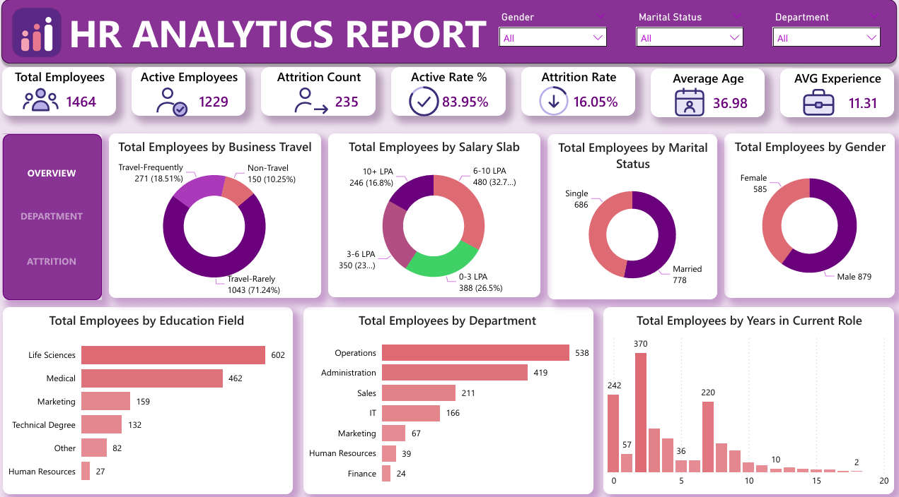
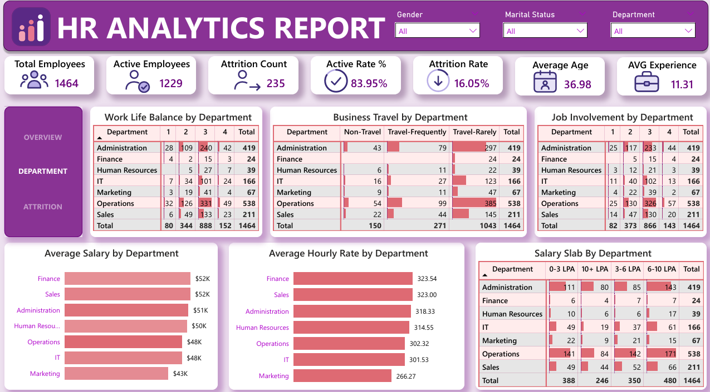
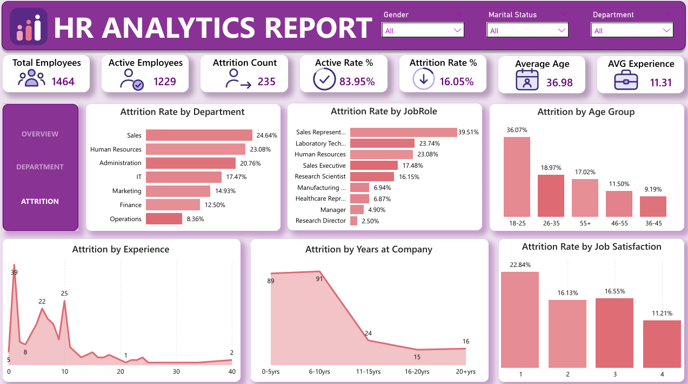

# HR Analytics Dashboard (Power BI)

An interactive 3-page Power BI report that analyses workforce structure, department performance and employee attrition for 1,464 employees.

## Business Problem
HR leadership needs to understand who works in the company, how departments compare, and why employees leave. This dashboard answers:
- What is the overall attrition rate, and which groups are most affected?
- How do work-life balance, job involvement, travel and pay differ by department?
- Which roles, age groups and tenure bands have the highest attrition?

## Dashboard Preview
### Overview

### Department

### Attrition

## Key KPIs
| KPI | Value |
|---|---|
| Total Employees | 1,464 |
| Active Employees | 1,229 |
| Attrition Count | 235 |
| Active Rate | 83.95% |
| Attrition Rate | 16.05% |
| Average Age | 36.98 |
| Average Experience | 11.31 years |

Attrition Rate = Attrition Count ÷ Total Employees (235 ÷ 1,464).

## Key Insights
1. **Sales has the highest attrition by department (24.64%)**, followed by Human Resources (23.08%) and Administration (20.76%). Operations is lowest at 8.36%.
2. **Sales Representatives leave most (39.51%)**, far above the company average of 16.05%. Research Directors (2.50%) and Managers (4.90%) are the most stable.
3. **Young employees are the highest risk.** Ages 18-25 have 36.07% attrition, nearly double the next group (26-35 at 18.97%).
4. **Most leavers have short tenure.** 180 of the 235 leavers (about 77%) had 10 years or less at the company.
5. **Workforce profile:** 60% male (879) and 40% female (585); 53% married; most employees (71.24%) travel rarely.
6. **Operations is the largest department (538 employees)** and also the most stable, which suggests its practices are worth studying.

## Recommendations
- Review compensation, targets and career paths for Sales Representatives.
- Start retention programmes (mentoring, onboarding support) for employees under 26.
- Run stay interviews in the first 10 years of employment.
- Learn from Operations: find out what keeps attrition low there.

## Dashboard Pages
- **Overview:** headcount KPIs, business travel, salary slab, marital status, gender, education field, department and years in current role.
- **Department:** work-life balance, business travel and job involvement by department, plus average salary and hourly rate.
- **Attrition:** attrition by department, job role, age group, experience, years at company and job satisfaction.

## Tools Used
- Power BI Desktop
- DAX (calculated measures)
- Excel (data preparation)

## Files
- `HR_Analytics_Dashboard.pbix`: the Power BI report
- `HR_Analytics_Report.pdf`: PDF export of all pages
- `data/`: dataset used
- `screenshots/`: dashboard images

## Author
**Abjunited**: aspiring Data Analyst skilled in Excel, MySQL, Power BI and DAX.
